<div align="center">

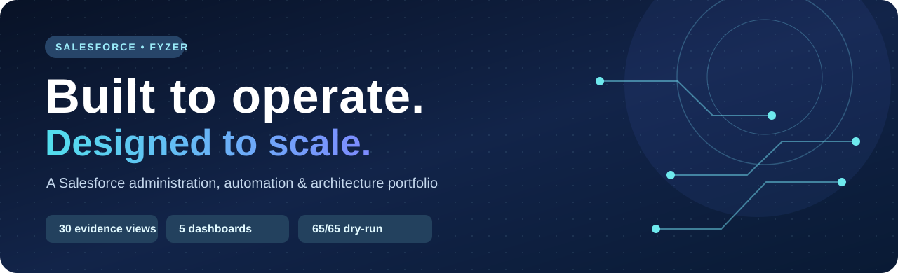

# FYZER · Salesforce Administration Case Study

**From disconnected customer operations to a governed Lead-to-Service workflow.**

  

**Salesforce Administration & Solution Design | Fictional B2B implementation | Developer Edition**

[Business case](docs/business-case-study.md) · [Technical design](docs/technical-design.md) · [Test evidence](fyzer-salesforce-portfolio-evidence/reports/testing-evidence.md) · [Engineering decisions](docs/governance.md)

</div>

---

## The organizational challenge

FYZER is a **fictional B2B software business** used to demonstrate how a Salesforce Administrator can diagnose and redesign an operational workflow. The modeled problems: leads lack clear ownership; opportunities and customer onboarding are disconnected; support lacks consistent routing and SLA visibility; finance handoffs and delivery profitability are difficult to trace; and administrators need stronger governance.

**The assignment:** Build a connected, least-privilege Salesforce operating model using configuration-first tools, test its behavior with fictional records, and leave maintainable evidence for the next administrator.

**What was demonstrated:** Lead assignment and conversion, Closed Won handoffs without duplicates on repeat edits, quote approval, project profit calculations, REST responses, five dashboards, and a check-only deployment validation. These are **test outcomes**, not measured real-world savings or revenue gains.

**Project context:** Independent portfolio implementation using fictional business data. Quote-to-Cash and professional services delivery workflows are labeled simulations; no licensed Salesforce CPQ or Certinia products are claimed.

## Implementation case studies

Each case links a business requirement to a configured solution and a screenshot captured from the project. Click an image to view it at full resolution.

## Foundation & access governance

### 01 · A consistent organizational baseline

**Business requirement:** Fragmented environments make currency, locale and account governance unpredictable.

**Implementation:** Configured and audited the FYZER Developer Edition company information as a controlled demonstration environment.


[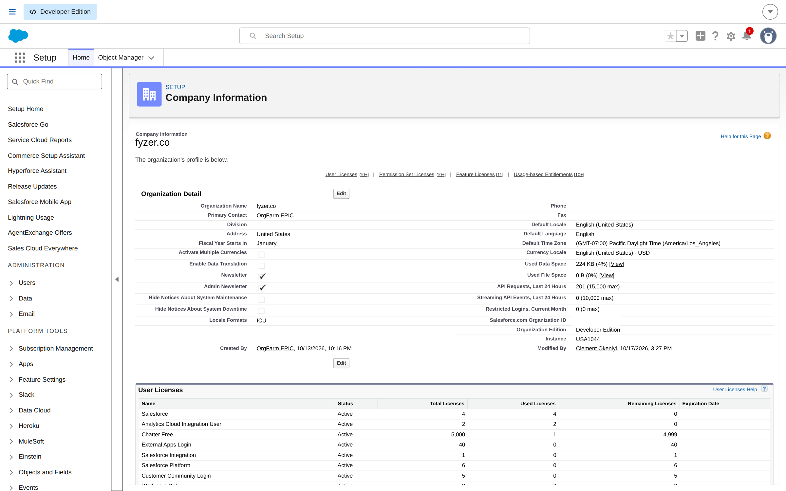](fyzer-salesforce-portfolio-evidence/screenshots/01-org-setup.png)

---

### 02 · Reporting lines without unrestricted visibility

**Business requirement:** Unstructured user hierarchies can expose records beyond reporting needs.

**Implementation:** Modeled the FYZER executive and operational reporting structure using Salesforce roles.


[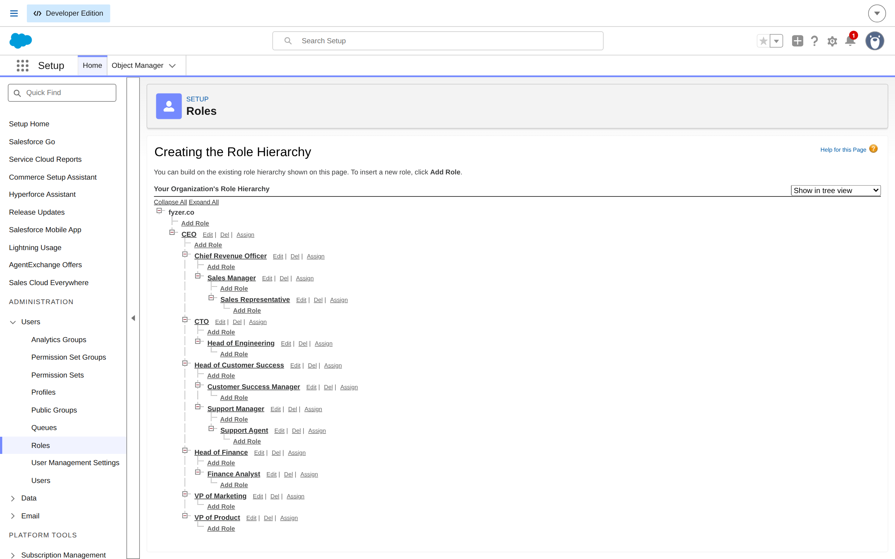](fyzer-salesforce-portfolio-evidence/screenshots/02-role-hierarchy.png)

---

### 03 · Permissions attached to duties, not individuals

**Business requirement:** Ad hoc user permissions are difficult to audit and sustain.

**Implementation:** Created departmental permission sets separating sales, customer success, support, management and finance access.


[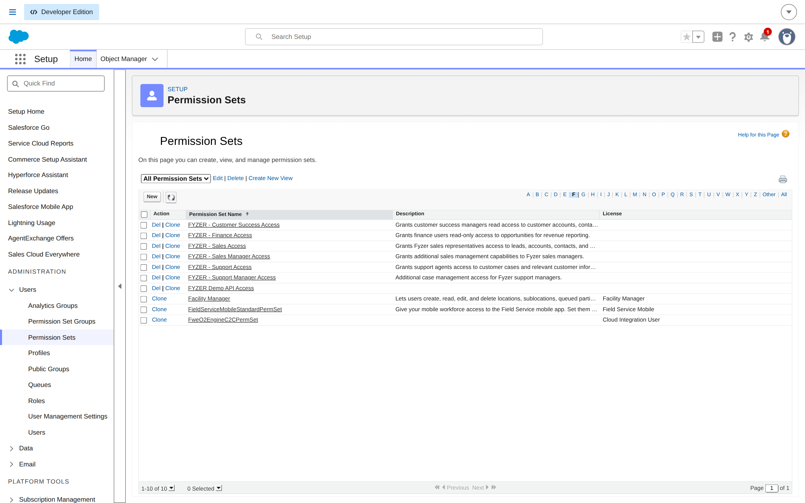](fyzer-salesforce-portfolio-evidence/screenshots/03-permission-sets.png)

---

### 04 · Repeatable onboarding for each job role

**Business requirement:** Manually granting multiple rights to every new employee invites omissions.

**Implementation:** Composed job-role permission set groups so access packages can be assigned consistently.


[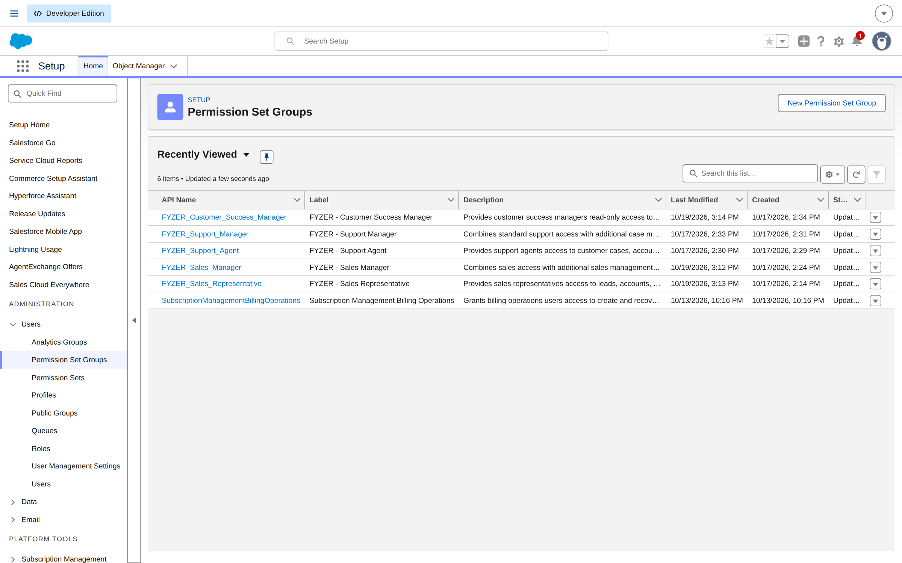](fyzer-salesforce-portfolio-evidence/screenshots/04-permission-set-groups.png)

---

### 05 · Customer records private by default

**Business requirement:** Open record visibility increases exposure and reduces ownership clarity.

**Implementation:** Set private sharing defaults and a targeted Sales-to-Customer-Success sharing rule.


[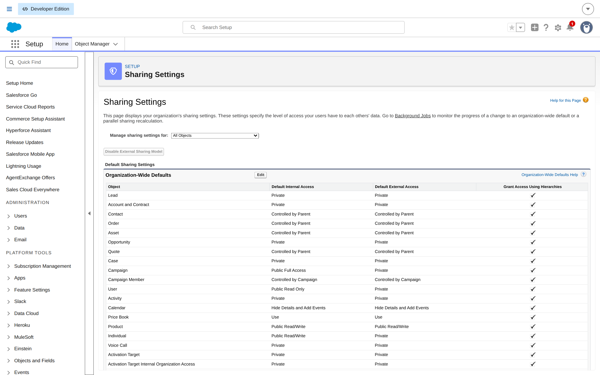](fyzer-salesforce-portfolio-evidence/screenshots/05-owd-sharing-rules.png)

---

### 06 · Define role-based user access

**Business requirement:** Testing only as a System Administrator hides permission problems.

**Implementation:** Provisioned Sales and Customer Success test users on Minimum Access profiles with job-role grants.


[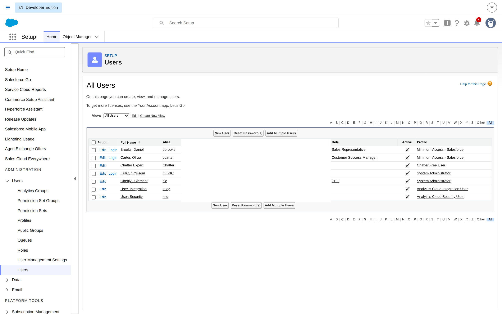](fyzer-salesforce-portfolio-evidence/screenshots/06-least-privilege-test-users.png)

---

### 07 · A single customer-lifecycle vocabulary

**Business requirement:** Different teams can describe the same customer in inconsistent terms.

**Implementation:** Introduced Customer Lifecycle Stage with seven agreed states to drive handoffs and reporting.


[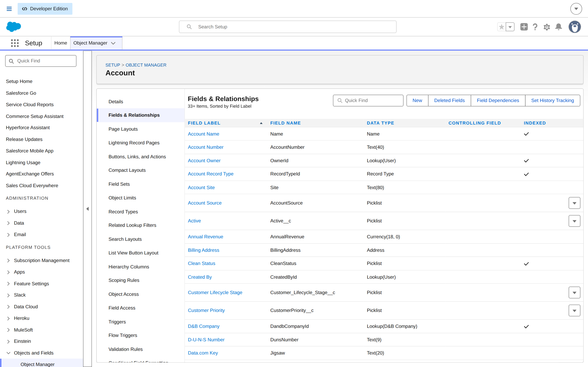](fyzer-salesforce-portfolio-evidence/screenshots/07-lifecycle-stage-field.png)

---

### 08 · Prevent activation without an SLA commitment

**Business requirement:** Marking customers active without support dates undermines accountability.

**Implementation:** Added an Account validation rule requiring an SLA expiration date before Active Customer status.


[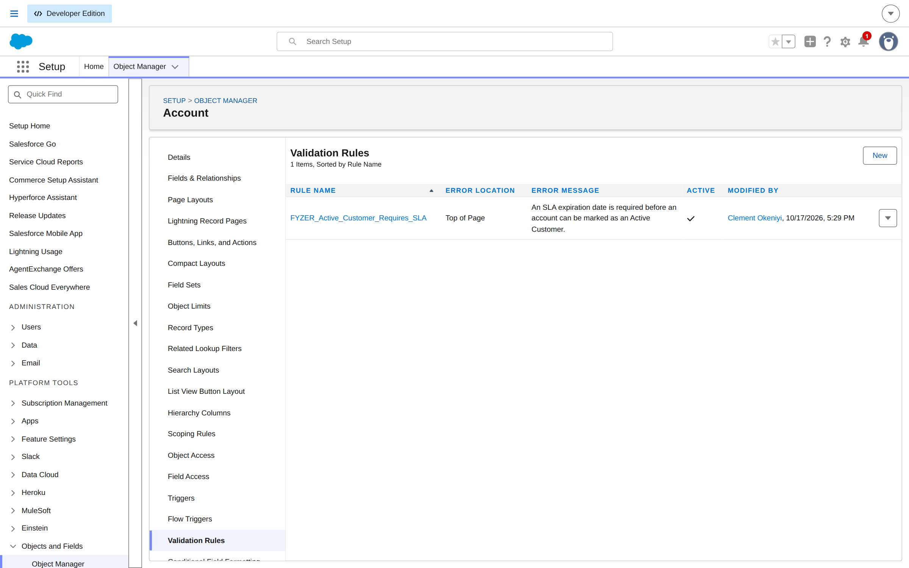](fyzer-salesforce-portfolio-evidence/screenshots/08-account-security-validation.png)

---

### 09 · Different experiences for prospects and customers

**Business requirement:** A one-size-fits-all Account layout introduces clutter and confusion.

**Implementation:** Configured Prospect and Customer record types and a purpose-built Lightning record page.


[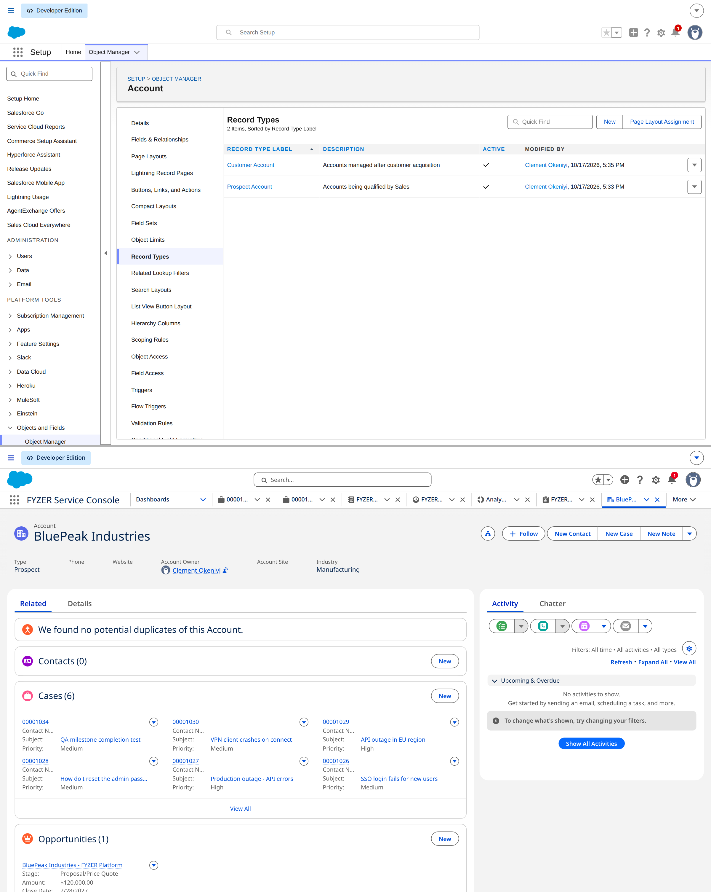](fyzer-salesforce-portfolio-evidence/screenshots/09-record-types-lightning-page.png)

---


## Lead management & revenue operations

### 10 · Web inquiries need a clear owner

**Business requirement:** Unassigned inbound leads can sit untouched.

**Implementation:** Enabled Web-to-Lead and active assignment rules: Web leads to the Sales Leads queue, all others to a named rep.


[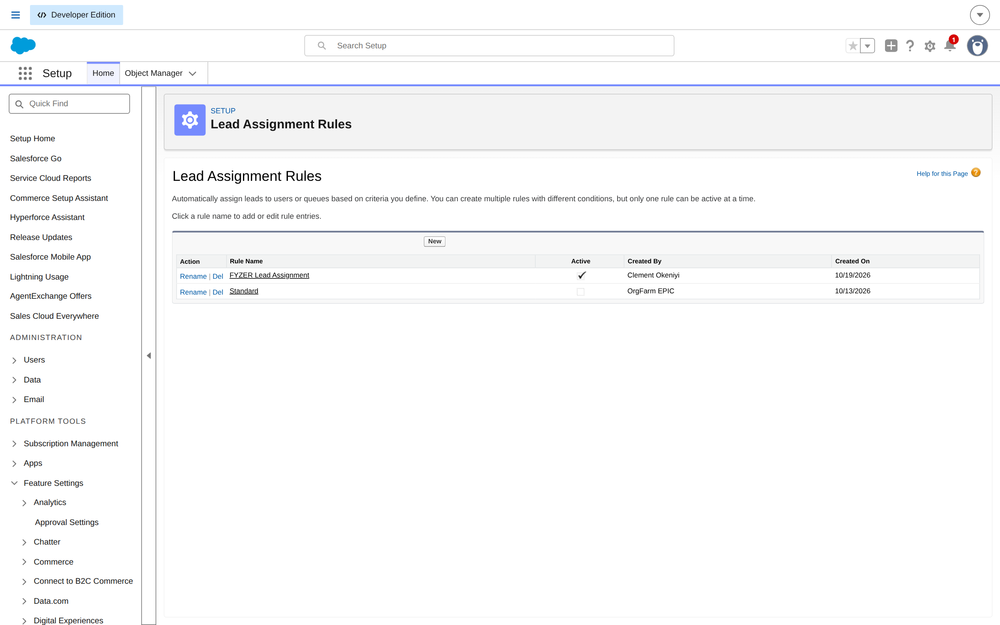](fyzer-salesforce-portfolio-evidence/screenshots/10-lead-assignment.png)

---

### 11 · Qualification must connect to the sales pipeline

**Business requirement:** Disconnected lead records force duplicate entry during qualification.

**Implementation:** Implemented a Lead Path and converted Ava Novak into Vertex Analytics Account, Contact and Opportunity.


[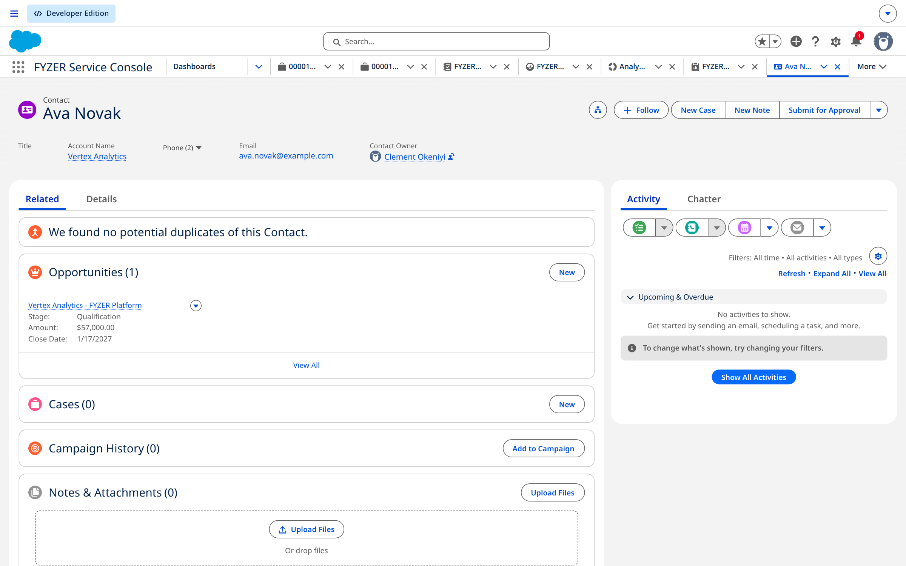](fyzer-salesforce-portfolio-evidence/screenshots/11-lead-conversion.png)

---

### 12 · Customer records must link across objects

**Business requirement:** Separate lists obscure customer context.

**Implementation:** Created a coherent fictional B2B dataset with related Accounts, Contacts and Opportunities.


[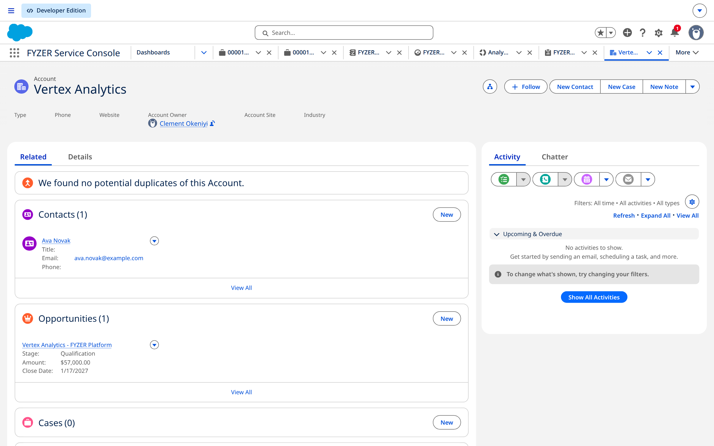](fyzer-salesforce-portfolio-evidence/screenshots/12-accounts-contacts-data.png)

---

### 13 · A pipeline managers can actually inspect

**Business requirement:** Spreadsheet-driven opportunities make stage and forecast review inconsistent.

**Implementation:** Configured an Opportunity Path and populated a Kanban board with active and won deals.


[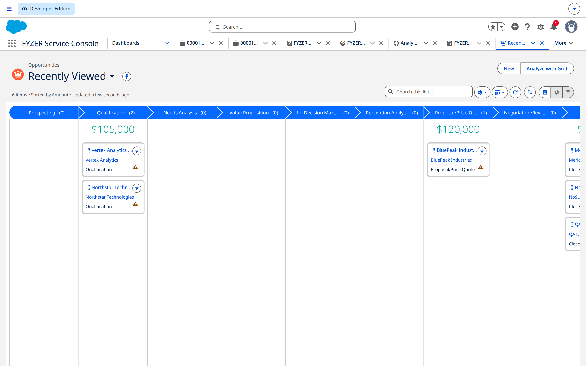](fyzer-salesforce-portfolio-evidence/screenshots/13-opportunity-pipeline.png)

---

### 14 · Discounts need consistent product pricing

**Business requirement:** Uncontrolled one-off quotes cause pricing drift.

**Implementation:** Created four FYZER offerings with Standard and 10%-discounted Enterprise Price Books.


[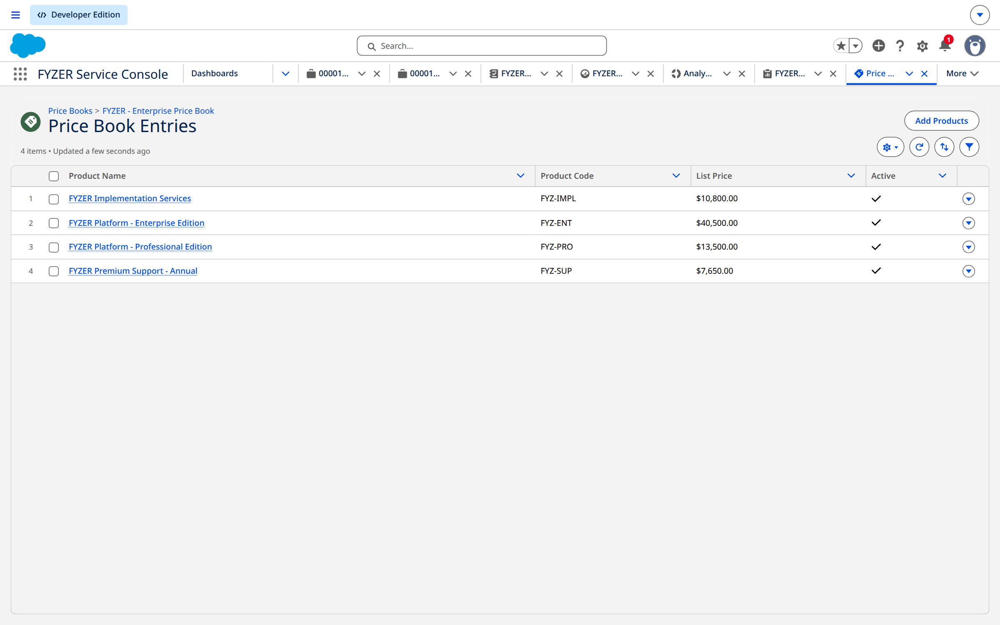](fyzer-salesforce-portfolio-evidence/screenshots/14-products-price-books.png)

---

### 15 · Pipeline performance should be visible

**Business requirement:** Sales leadership lacks a shared view when every rep reports separately.

**Implementation:** Built the FYZER Sales Dashboard on Salesforce reports.


[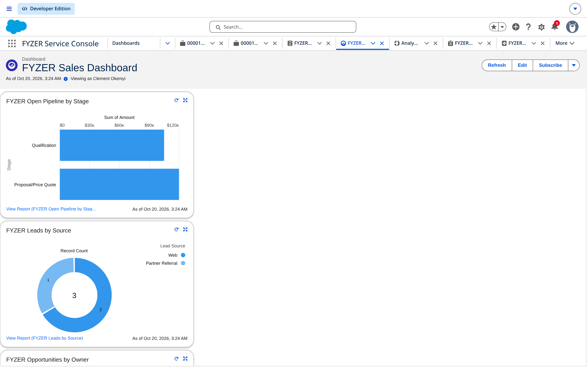](fyzer-salesforce-portfolio-evidence/screenshots/15-sales-dashboard.png)

---


## Service operations & SLA governance

### 16 · Support agents need one place to work

**Business requirement:** Case context scattered across screens slows triage.

**Implementation:** Built the FYZER Service Console with contextual case details and a resolution Path.


[](fyzer-salesforce-portfolio-evidence/screenshots/16-service-console.png)

---

### 17 · Urgent cases must reach the right team

**Business requirement:** Without systematic assignment, high-priority incidents may be overlooked.

**Implementation:** Configured a Support Queue, case assignment and four-hour high-priority escalation criteria.


[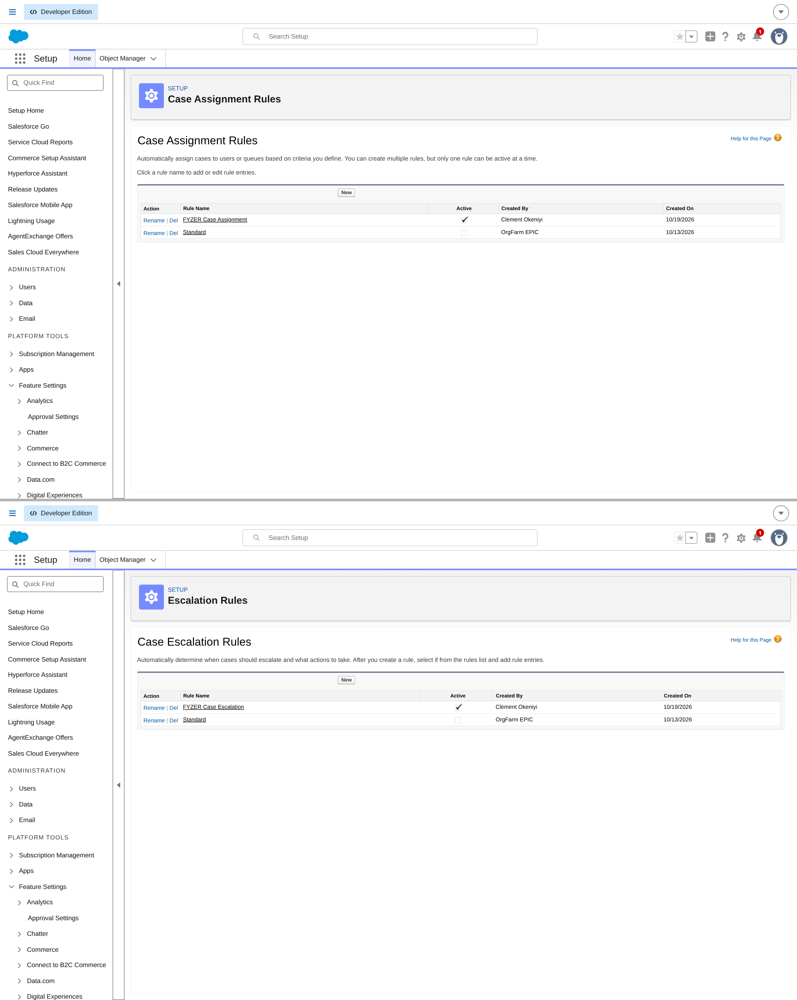](fyzer-salesforce-portfolio-evidence/screenshots/17-case-routing-escalation.png)

---

### 18 · Surface support commitments on each case

**Business requirement:** Agents need clear first-response and resolution targets.

**Implementation:** Attached customer entitlements automatically and surfaced live Case milestones.


[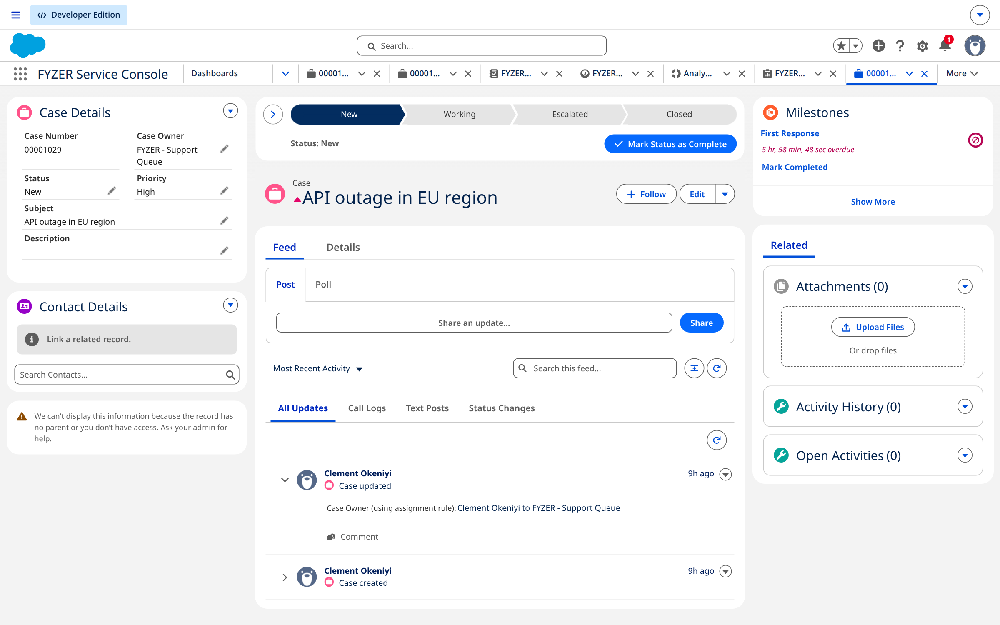](fyzer-salesforce-portfolio-evidence/screenshots/18-entitlement-sla.png)

---

### 19 · See support workload before it becomes a crisis

**Business requirement:** Managers need consolidated case volume and priority signals.

**Implementation:** Built a Service Dashboard using case reports and operational measures.


[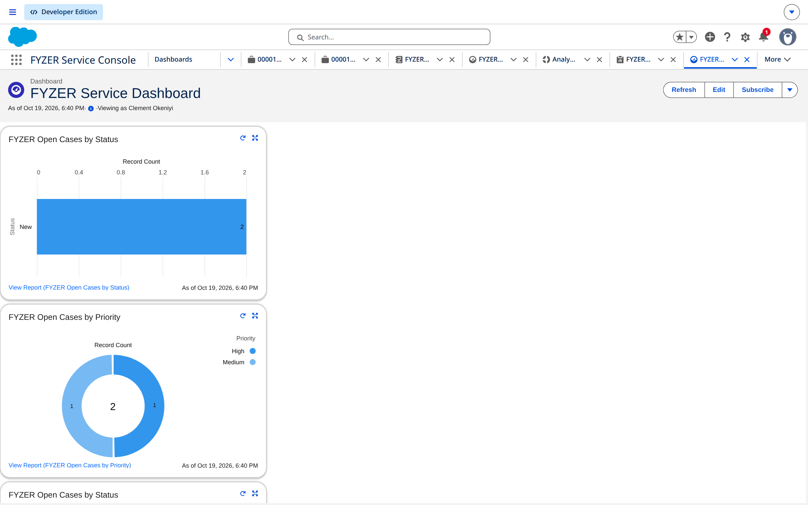](fyzer-salesforce-portfolio-evidence/screenshots/19-service-dashboard.png)

---


## Automated handoffs & fault handling

### 20 · Avoid manual SLA attachment

**Business requirement:** Manual case setup can omit entitlements.

**Implementation:** Built active case-triggered automation to attach the matching active entitlement when applicable.


[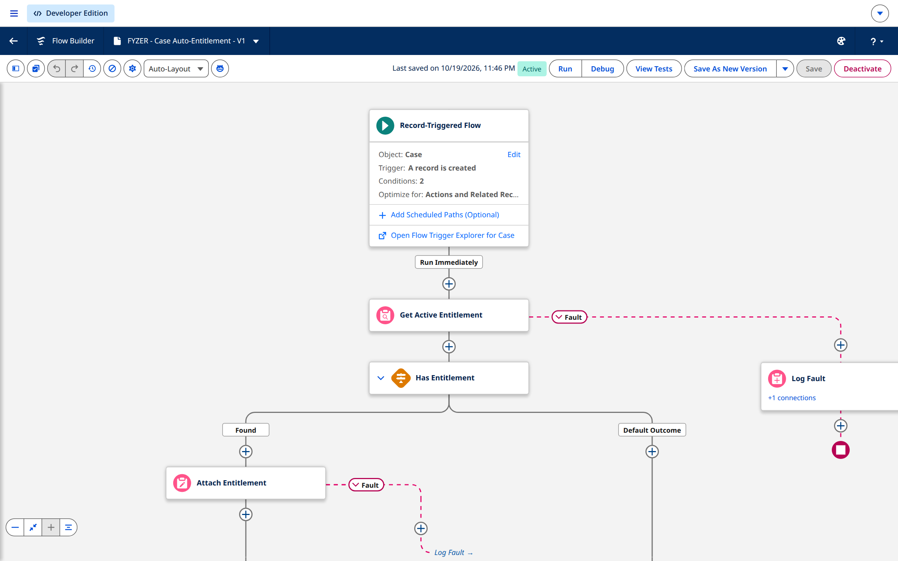](fyzer-salesforce-portfolio-evidence/screenshots/20-record-triggered-flow.png)

---

### 21 · Onboarding should be consistent

**Business requirement:** Account activation done manually invites missing fields and follow-ups.

**Implementation:** Built a guided Customer Onboarding Screen Flow with a reusable task-creation subflow.


[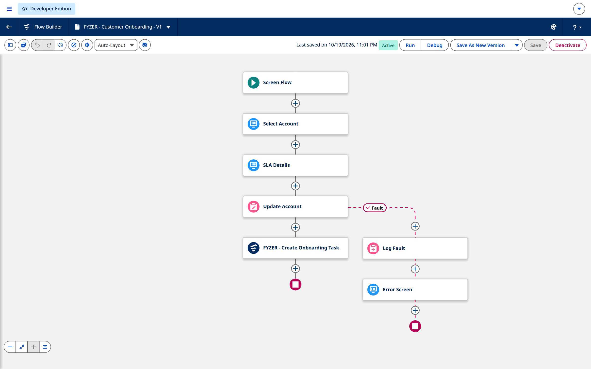](fyzer-salesforce-portfolio-evidence/screenshots/21-customer-onboarding-screen-flow.png)

---

### 22 · Closed Won is a handoff, not the finish line

**Business requirement:** Sales wins can stall while Customer Success, Support and Finance wait for a message.

**Implementation:** Triggered customer-lifecycle changes and welcome, health-check and invoice-prep activities on transitions.


[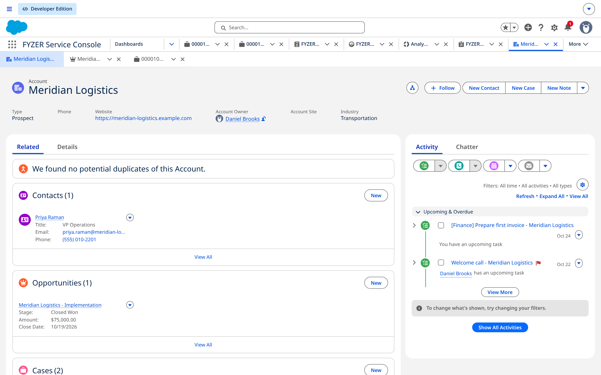](fyzer-salesforce-portfolio-evidence/screenshots/22-cross-functional-automation.png)

---


## Commercial controls & project delivery

### 23 · Large quotes need an approval trail

**Business requirement:** High-value pricing decisions made informally are difficult to audit.

**Implementation:** Simulated standard Quote → approval → Order/Contract handoff, with a threshold above $50,000.


[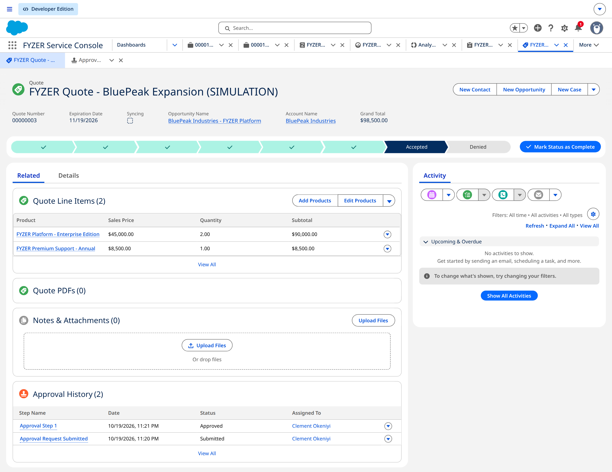](fyzer-salesforce-portfolio-evidence/screenshots/23-quote-to-cash.png)

---

### 24 · Time entries should reveal project margin

**Business requirement:** Delivery revenue means little without associated staffing cost.

**Implementation:** Built simulated projects, resources and timesheets with calculated profitability and utilization.


[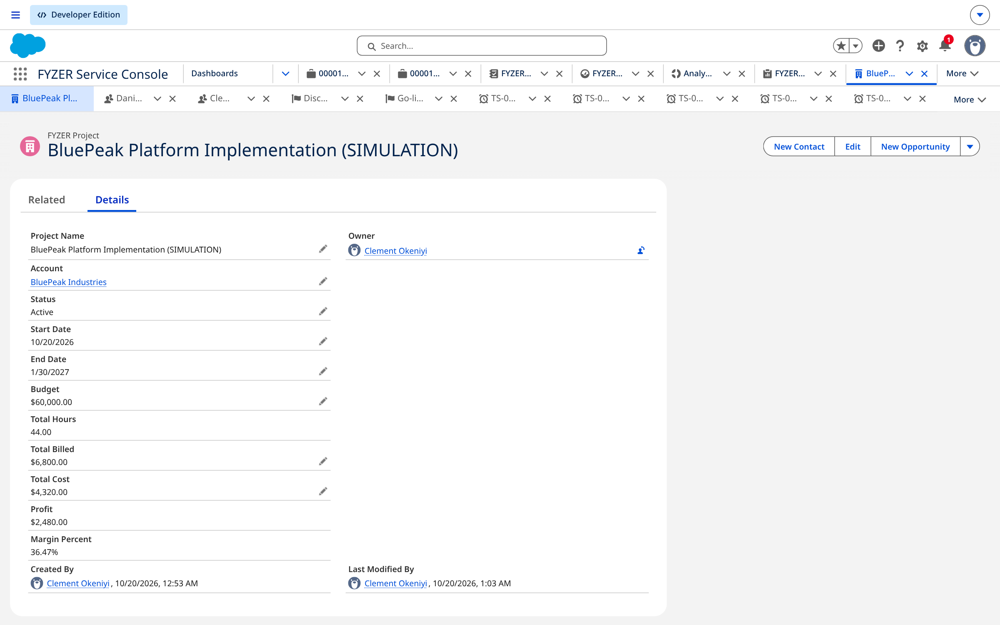](fyzer-salesforce-portfolio-evidence/screenshots/24-psa-profitability.png)

---


## Integration, insight & release governance

### 25 · External calls need traceability

**Business requirement:** Integrations that fail silently leave admins unable to troubleshoot.

**Implementation:** Used a Named Credential, Flow HTTP Callout, and Workbench REST tests with log records.


[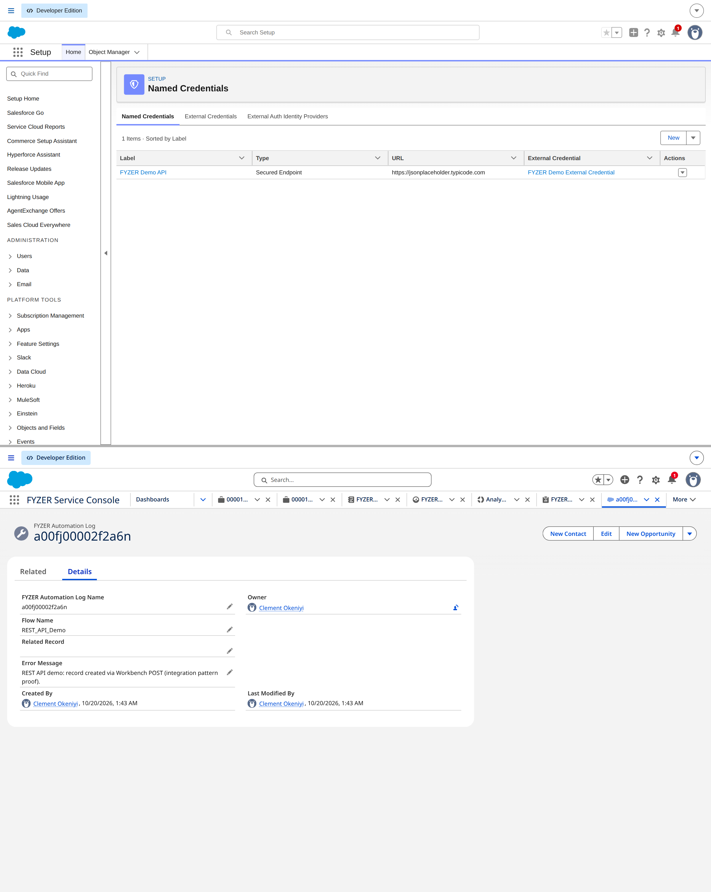](fyzer-salesforce-portfolio-evidence/screenshots/25-rest-api-integration.png)

---

### 26 · Duplicate leads pollute handoffs and reporting

**Business requirement:** Near-identical records can split history and mislead pipeline metrics.

**Implementation:** Activated exact-email/fuzzy-name matching and warn-and-report duplicate behavior.


[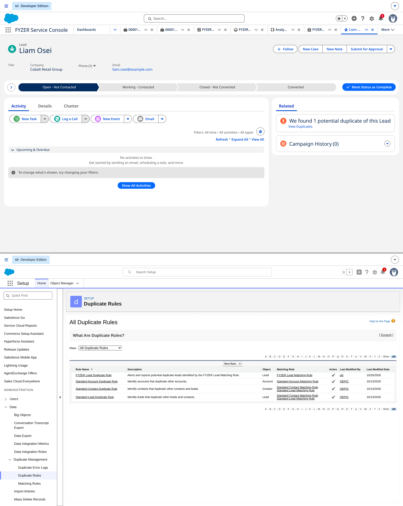](fyzer-salesforce-portfolio-evidence/screenshots/26-duplicate-detection.png)

---

### 27 · Configuration must remain understandable

**Business requirement:** Undocumented fields make future maintenance dependent on one person.

**Implementation:** Documented core objects, field definitions and the purposes of customizations.


[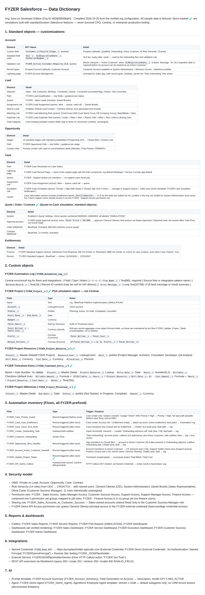](fyzer-salesforce-portfolio-evidence/screenshots/27-data-dictionary.png)

---

### 28 · Executives need one operational picture

**Business requirement:** Revenue, customer lifecycle and service data are easy to silo.

**Implementation:** Assembled executive, customer success and admin dashboards alongside sales and support views.


[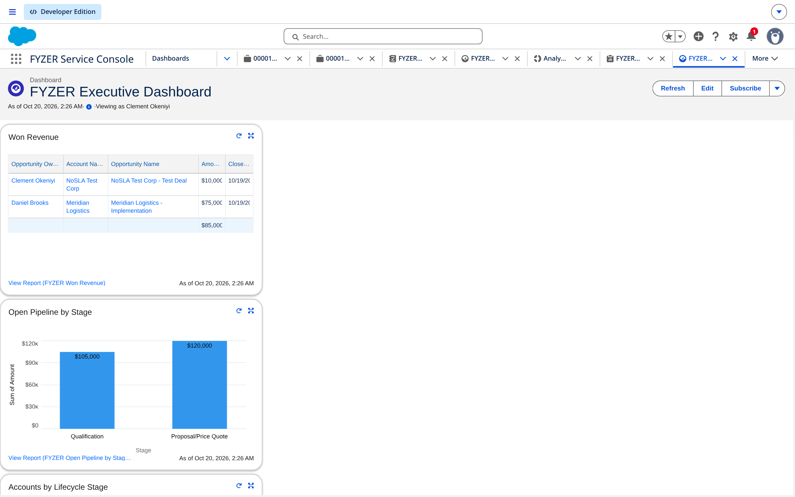](fyzer-salesforce-portfolio-evidence/screenshots/28-executive-dashboard.png)

---

### 29 · Govern AI-assisted account summaries

**Business requirement:** Generic AI answers can hallucinate account facts or claim inaccessible CRM data.

**Implementation:** Configured an Account Summary prompt template grounded in CRM fields, with human review required before using generated content. An exploratory Agentforce agent remains in Draft.


[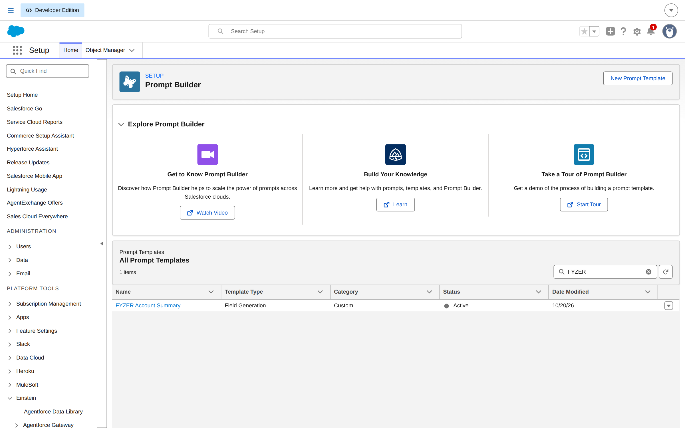](fyzer-salesforce-portfolio-evidence/screenshots/29-agentforce-ai.png)

---

### 30 · Configuration needs source control and validation

**Business requirement:** Untracked admin changes are hard to review or recover.

**Implementation:** Synced retrieved Salesforce DX metadata, recorded Git changes and a check-only deployment validation.


[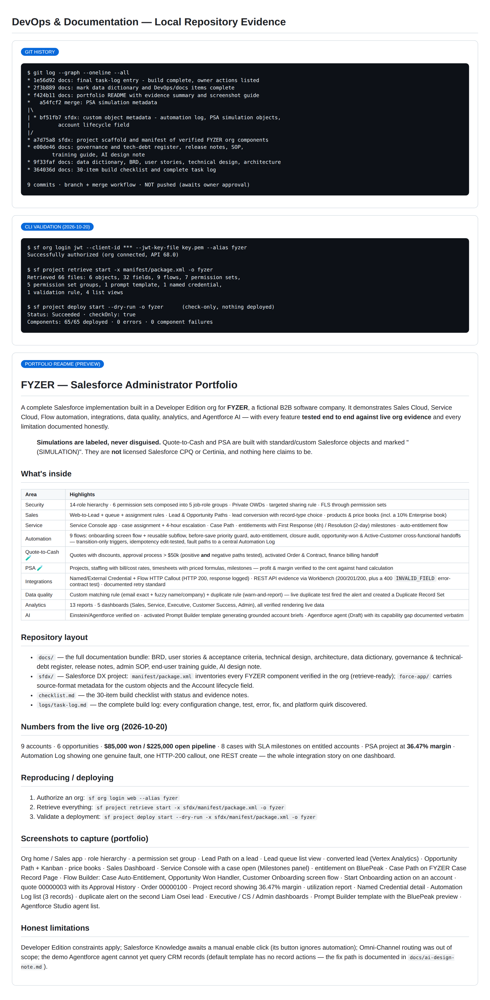](fyzer-salesforce-portfolio-evidence/screenshots/30-devops-documentation.png)

---

## System architecture

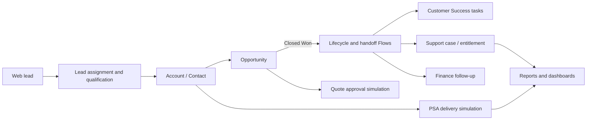

## Implementation validation

| Area | Documented evidence / status |
|---|---|
| Lead routing | Web lead → Sales queue; catch-all → representative |
| Lead conversion | Ava Novak → Vertex Analytics Account, Contact and Opportunity |
| Cross-team handoff | Artifacts created once; subsequent record edits did not duplicate them |
| Quote approval | $98,500 quote followed the approval path; lower quotes did not |
| PSA arithmetic | 44h · $6,800 billed · $4,320 cost · $2,480 profit · 36.47% margin |
| REST API | HTTP 200/201 success and 400 error contract documented |
| Source validation | Reported Salesforce DX dry-run 65/65 components, zero errors |


**Engineering follow-up:** The QA register tracks outstanding items separately from verified outcomes, including milestone completion on case closure, PSA financial totals following deletion, and the draft agent's CRM-access capabilities. These are retained as documented follow-up work rather than presented as delivered functionality. [Review the technical-debt register](fyzer-salesforce-portfolio-evidence/reports/known-issues.md).

[Read test evidence](fyzer-salesforce-portfolio-evidence/reports/testing-evidence.md) · [Full QA](fyzer-salesforce-portfolio-evidence/reports/final-qa-results.md) · [Engineering decisions](docs/governance.md)

## Documentation

| Planning | Implementation and governance |
|---|---|
| [Business case study](docs/business-case-study.md) | [Architecture](docs/architecture.md) |
| [Business requirements](docs/brd.md) | [Technical design](docs/technical-design.md) |
| [User stories](docs/user-stories.md) | [Admin SOP](docs/sop.md) |
| [Data dictionary](docs/data-dictionary.md) | [Training guide](docs/training-guide.md) |
| [AI governance](docs/ai-design-note.md) | [Release notes](docs/release-notes.md) |
| [Completion checklist](fyzer-salesforce-portfolio-evidence/reports/completion-checklist.md) | [Deployment validation](fyzer-salesforce-portfolio-evidence/reports/deployment-validation.md) |

## Source code & release controls

The `sfdx/` directory contains retrieved Salesforce metadata and a deployment manifest. A check-only validation against the authorized Developer Edition org was reported as **65/65 components, zero component errors**. This validates the tested metadata scope; it does not guarantee deployment into an unrelated org with different dependencies or entitlements.

```bash
sf project deploy start --dry-run --manifest manifest/package.xml --target-org fyzer
```

Changes intended for another environment require dependency review, permission review, and a documented rollback plan.

## Repository structure

- `sfdx/` — Salesforce DX project and retrieved source metadata
- `docs/` — requirements, architecture, operating procedures and technical decisions
- `fyzer-salesforce-portfolio-evidence/screenshots/` — the 30 images shown throughout this README
- `fyzer-salesforce-portfolio-evidence/reports/` — QA, test results and documented limitations
- `logs/` — build and implementation records

---

<div align="center">

**FYZER | Workflow design, access governance, and evidence-led validation.**

*Independent Salesforce portfolio project · Fictional business scenario*

</div>
